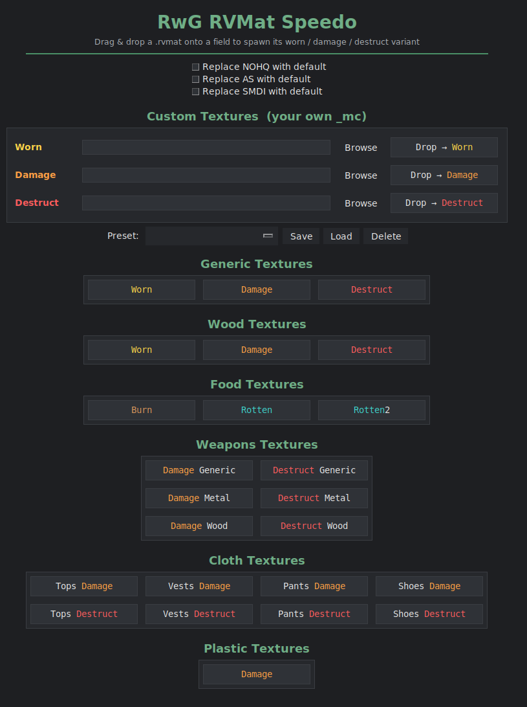

# RwG RVMat Speedo

Quickly spawn **damaged / destroyed / worn `.rvmat`** variants for DayZ by
**drag & drop**. Drop your original `.rvmat` onto a field and a new file with the
matching suffix (`_worn`, `_damage`, `_destruct`, …) is written next to it, with
the right damage/destruct **`_mc`** texture swapped into `Stage3`.



> Video walkthrough: https://youtu.be/3A_nh4P5XZA

## What it does

Dropping a `.rvmat` onto a field rewrites the material's `Stage3` texture to the
chosen damage/destruct `_mc` map and saves a **new** file (e.g. `helmet.rvmat`
→ `helmet_damage.rvmat`) — the original is untouched.

- **Built-in DayZ textures**, grouped by category: Generic, Wood, Food, Weapons
  (generic / metal / wood), Cloth (tops / vests / pants / shoes), Plastic.
- **Custom Textures** — enter your **own** `_mc` paths for Worn / Damage /
  Destruct and drop onto their fields to bake them in. **Save / Load** named
  presets so your mod's texture set is one click away.
- **Optional default channels** — tick to also replace `NOHQ`, `AS` and/or
  `SMDI` (`Stage1/4/5`) with DayZ's flat default color values.
- Green hover feedback on every drop field; dark RwG interface.

## Custom textures & presets

1. In **Custom Textures**, type or **Browse** the mod-relative `_mc` path for
   **Worn**, **Damage** and/or **Destruct** (e.g. `MyMod\data\item_damage_mc.paa`).
2. Drop a `.rvmat` onto that field — it uses your path instead of a built-in one.
3. **Save** stores the three paths under a name; **Load** brings them back;
   **Delete** removes the selected preset. Presets live in
   `rvmat_speedo_presets.json` next to the app.

## Run

```
pip install tkinterdnd2
python RwG_RVMat_Speedo.py
```

Or grab the packaged **`RwG_RVMat_Speedo.exe`** from the
[Releases](../../releases) — no Python needed.

### Build the .exe

```
pip install pyinstaller tkinterdnd2
pyinstaller RwG_RVMat_Speedo.spec
```

The result is `dist\RwG_RVMat_Speedo.exe`.

## Documentation

- [**Wiki**](../../wiki) — how the `.rvmat` stages work, every category, custom
  textures & presets, tips, troubleshooting.
- [`CHANGELOG.md`](CHANGELOG.md) — what changed.

## License

GPL-3.0 — see [`LICENSE`](LICENSE). More tools & guides:
[rwg-addon.com](https://rwg-addon.com/).
